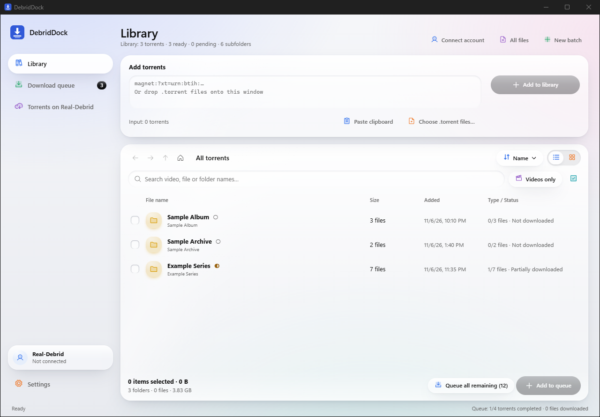
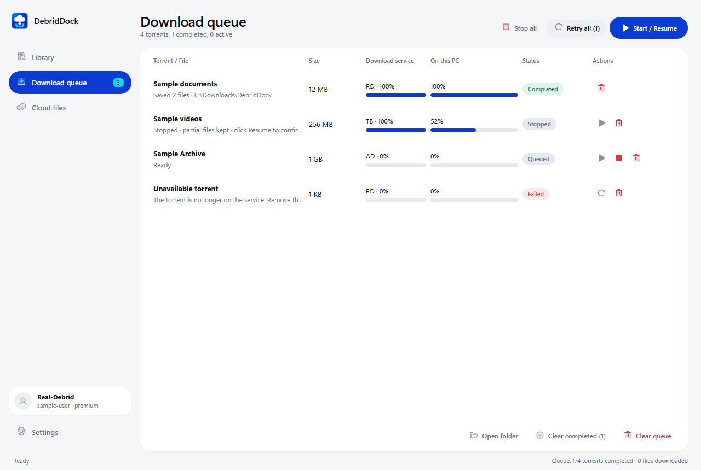
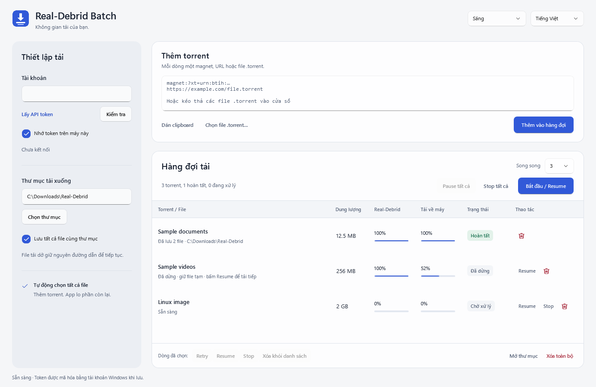

# DebridDock: all-in-one desktop app for Real-Debrid, TorBox and AllDebrid

English · [Tiếng Việt](README.vi.md)

[](https://github.com/coolbirdzik/realdebrid/actions/workflows/build.yml)


**DebridDock is a free desktop debrid client: one app to add torrents to Real-Debrid, TorBox or AllDebrid, browse
them in a virtual library, pick the exact files you want and download them to your computer through a fast,
resumable download queue.** It replaces the browser tabs, copy-pasted links and separate download manager you would
otherwise juggle for each debrid service. It runs on Windows, macOS and Linux.



## Contents

- [Why DebridDock](#why-debriddock)
- [Features](#features)
- [How it works](#how-it-works)
- [Screenshots](#screenshots)
- [Download and install](#download-and-install)
- [FAQ](#faq)
- [For developers](#for-developers)

## Why DebridDock

A debrid service downloads a torrent on its own fast servers and gives you a direct HTTPS link. Doing that by hand
for a season of episodes or a large batch means adding each magnet on the website, waiting, selecting files,
unrestricting every link and feeding the links to a download manager. DebridDock does the whole chain in one window:

- **One UI for every debrid service.** Real-Debrid, TorBox and AllDebrid share the same library, queue and controls.
  Switch service in Settings; each one keeps its own token and torrents.
- **A virtual library instead of a pile of links.** Torrents are read on the service and shown as folders and files,
  like a file explorer, before anything reaches your disk.
- **Download only what you choose.** Pick single videos, whole folders or everything left, and only those files are
  selected on the service and downloaded.
- **A download queue you can leave running.** Downloads start as soon as you queue them, resume after a stop or a
  crash, and retry by themselves when a connection drops.

## Features

### All-in-one debrid client

- Supports **Real-Debrid, TorBox and AllDebrid**. Each service is a separate adapter behind one interface, so more
  can be added.
- Add **magnet links**, **`.torrent` URLs** or **local `.torrent` files** (paste a list, or drag and drop files onto
  the window). Duplicates are detected.
- See and clean up the **torrents on your debrid account**: list every torrent and delete the ones you no longer
  need, with a review step before anything is removed.

### Virtual torrent library

- Browse every torrent as **folders and files**, with back, forward and up navigation (mouse side buttons, Alt+←/→
  and Backspace work too), breadcrumbs and an **All files** flat view.
- **List or grid view**, sorting by name or date added, and sortable columns (name, size, status).
- **Search** across folders and subfolders, and a **Videos only** filter that surfaces every video in the current
  folder tree.
- Each file shows whether it is **downloaded, partly downloaded or already queued**, and keeps that mark after you
  clear the queue or restart the app.
- Remove files or folders from the library without touching your disk or the service, with undo (Ctrl+Z).

### Torrent downloads from debrid

- **Queue selected files, or everything that is left** in the library, with one click. Downloads start right away.
- **Resumable downloads** (`Range` + `If-Range`): stop, pause or close the app and continue from the exact byte later.
- **Automatic retry:** a dropped connection, a timeout or an expired download link is retried with back-off and
  resumes the partial file. **Retry all** is there for anything that still fails.
- Choose the **download folder**, keep the torrent's folder structure or save everything flat, and run **1 to 5
  torrents at the same time**.
- Progress shows both sides: the service's progress and the download to your computer, with speed and file count.

### Fast, private, cross-platform

- Built with **Rust** (download engine) and **Tauri 2** (native shell), so it is small and light on memory.
- Stays responsive with **30,000+ files** in the library and **thousands of files** in a single torrent.
- Your API token is stored in the **operating system keychain** (Windows Credential Manager, macOS Keychain, Linux
  Secret Service), never in a plain settings file, and never shown in error messages.
- Windows, macOS and Linux installers, and a **portable Windows build** that keeps all data next to the app.
- Interface in English, Vietnamese, Simplified Chinese, Turkish, Spanish, German, French, Korean, Japanese, Brazilian Portuguese and Russian; light and dark appearance.

## How it works

1. **Connect your service.** Choose Real-Debrid, TorBox or AllDebrid in Settings and paste your API token (the app
   links to each service's token page).
2. **Add torrents.** Paste magnet links or `.torrent` URLs, or drop `.torrent` files. DebridDock adds them to your
   debrid account and reads their file lists.
3. **Browse and pick.** Open folders in the virtual library, search, filter to videos and select what you want.
4. **Download.** Click **Add to queue**. DebridDock selects those files on the service, waits for it to finish, gets
   the direct links and downloads them to your folder with resume and automatic retry.

DebridDock never connects to torrent peers itself: your computer only downloads over HTTPS from your debrid service.

## Screenshots



<details>
<summary>Dark appearance and Vietnamese interface</summary>




</details>

The screenshots come from the real app with sample data (`scripts/seed-sample-data.py`); no account or transfer is
involved.

## Download and install

Get the installer for your system from the [Releases](https://github.com/coolbirdzik/realdebrid/releases) page:
`.msi` or `.exe` for Windows, `.dmg` for macOS, `.deb`, `.rpm` or `.AppImage` for Linux. For Windows there is also
`DebridDock-portable-win-x64.zip`: unzip it anywhere and run `DebridDock.exe`; the queue, library and settings stay in
a `data` folder next to it (the WebView2 runtime, included with Windows 11, must be installed). It can also be built
from source with `pnpm build:portable` (see [Build and test](#build-and-test)).

Builds are **not code-signed yet**, so the system warns on first launch:

- **Windows:** SmartScreen shows "Windows protected your PC". Click *More info*, then *Run anyway*.
- **macOS:** right-click the app and choose *Open*, or run `xattr -dr com.apple.quarantine "/Applications/DebridDock.app"`.
- **Linux:** the AppImage needs `chmod +x`. To remember the API token, the `.deb` and `.rpm` need a Secret Service
  keyring (GNOME Keyring or KWallet).

## FAQ

**What is a debrid service?**
A paid service such as Real-Debrid, TorBox or AllDebrid that downloads torrents (and files from file hosts) on its own
servers and gives you fast direct download links. DebridDock is a client for those services; you need your own
account and API token.

**Is DebridDock free?**
Yes. DebridDock is free and open source (MIT). You only pay for your debrid subscription.

**Does DebridDock download torrents with BitTorrent on my computer?**
No. The debrid service fetches the torrent. DebridDock only downloads the finished files over HTTPS, so no peers ever
see your IP address.

**Can I download only some files from a torrent, such as one episode?**
Yes. That is what the virtual library is for: open the torrent, select the files or folders you want and queue them.
Only those files are selected on the service and downloaded.

**What happens if my connection drops or I close the app mid-download?**
Partial files are kept. Connection problems are retried automatically, and after a restart **Start / Resume**
continues every file from the byte where it stopped.

**Does it work with several debrid accounts?**
You can keep a token for each service and switch between Real-Debrid, TorBox and AllDebrid in Settings. Each
queued torrent remembers the account it belongs to and is never resumed with another one.

**Where are my token and data stored?**
The token is in your system keychain. The library, queue and settings are in one `data.json` file in the app data
folder (or next to the app in the portable build).

Please download only content you have the right to download.

## For developers

DebridDock is a Rust core and download engine, a Tauri 2 shell and a Svelte 5 UI.

### Layout

| Path | What it is |
| --- | --- |
| `crates/core` | `rdbatch-core`: provider adapters, resumable downloader, queue engine, persistence. No UI or Tauri dependency, so `cargo test` runs anywhere. |
| `src-tauri` | `rdbatch-desktop`: application state, IPC commands, coalesced events, keychain access. |
| `src` | Svelte UI. `src/lib/browser.ts` holds the Library browser logic as pure, tested functions. |
| `scripts` | `check-i18n.mjs` (every UI string has an English translation, and every locale matches its keys and placeholders), `seed-sample-data.py` (sample library for screenshots), `fake-realdebrid.py` (fake server for end-to-end runs). |
| `.github/workflows/build.yml` | Tests on all three systems, builds installers and publishes releases. |

### Build and test

Requirements: Rust (stable), Node 22+, pnpm 10. On Linux also
`libwebkit2gtk-4.1-dev libayatana-appindicator3-dev librsvg2-dev libdbus-1-dev patchelf`.

```sh
pnpm install
pnpm tauri dev            # run the app
cargo test --workspace
pnpm check && pnpm test && node scripts/check-i18n.mjs
pnpm tauri build          # installers for the current OS, in target/release/bundle
pnpm build:portable       # portable build, in dist/portable and dist/DebridDock-portable-win-x64.zip (Windows)
```

`RDBATCH_DATA_DIR=<folder>` keeps all data (queue, library, settings) in one folder, for portable use, tests and
screenshots. The portable build ships a `portable` marker file next to the executable, which does the same with a
`data` folder beside it. API tokens are never written there; they live in the operating system keychain and fall back
to memory for the session if no keychain is available.

### How it stays fast

- Progress is never sent per chunk. The engine updates the queue; one task emits the latest copy of each changed job
  about every 250 ms. A busy UI cannot slow a transfer, and a fast transfer cannot flood the UI.
- Resuming a torrent matches all of its files in one pass, so a torrent with thousands of files resumes instantly.
- `data.json` is written atomically and debounced, except when a remote torrent ID is created: that is flushed
  immediately so a crash cannot orphan a torrent on the service.
- Lists are virtualized, and the Library filters 30,000 files in a few milliseconds (`browser.test.ts` checks it).

### Safety rules the tests cover

Resume with `Range` + `If-Range`, restart when the server ignores `Range`, reject a wrong `Content-Range`, never
accept a short body as finished, never overwrite a finished file, keep partial files when stopped, reject path
traversal and symlinked folders, retry connection failures but never replay an ambiguous upload or delete, keep
tokens out of every error message (including the TorBox download URL), refuse torrents from another account or
provider.

### Releases

`.github/workflows/build.yml` tests on all three systems and builds installers on every push to `main` and pull
request (uploaded as workflow artifacts for 14 days). For a tag named `vX.Y.Z` that matches the `version` in
`package.json` (the app, the installers and the update check all read it) it also publishes a GitHub release with checksums:

```sh
git tag -a v0.3.0 -m "Release v0.3.0"
git push origin v0.3.0
```

### History

DebridDock was called Real-Debrid Batch until it grew beyond one service. It began as a Windows-only WPF/.NET app;
that code was removed when the Tauri app replaced it and remains in the git history up to commit `8e3a5d1`.

## License

MIT.
