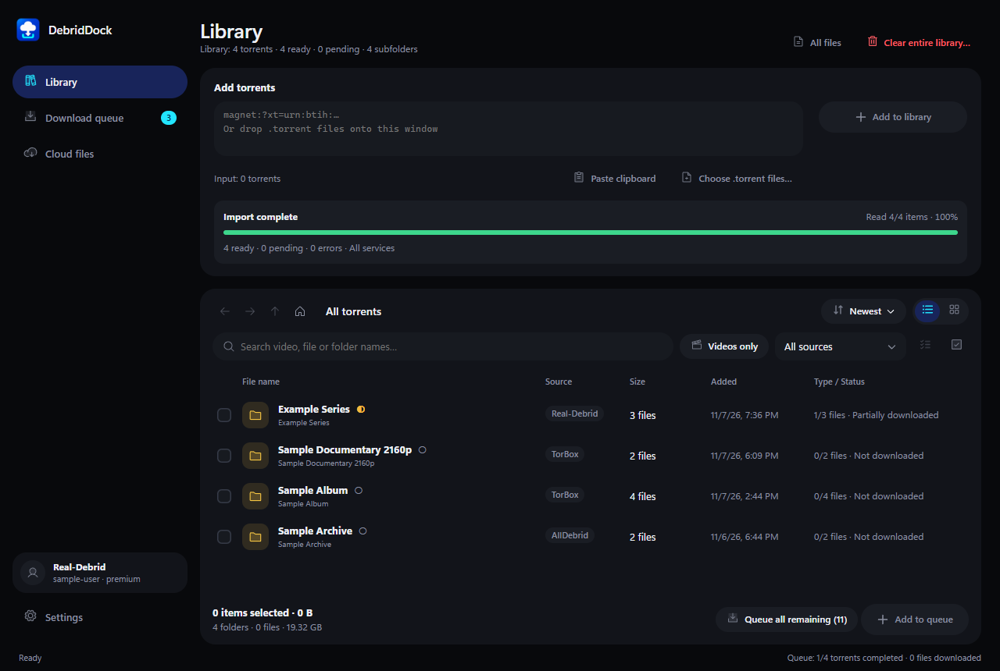

# Real-Debrid Torrent Multiple Downloader

English · [Tiếng Việt](README.vi.md)

[](https://github.com/coolbirdzik/realdebrid/actions/workflows/build-release.yml)

**[Download for Windows x64 (.exe)](https://github.com/coolbirdzik/realdebrid/releases/latest/download/RealDebridBatch-win-x64.exe)** · [ZIP package](https://github.com/coolbirdzik/realdebrid/releases/latest/download/RealDebridBatch-win-x64.zip) · [All releases](https://github.com/coolbirdzik/realdebrid/releases)

Download multiple torrents with Real-Debrid from a single Windows desktop queue. Add magnets, direct `.torrent` URLs or local `.torrent` files in bulk. Choose a download folder, add sources to the queue and click **Start / Resume**. The app selects **all files**, waits for Real-Debrid, then downloads everything to your computer.

## Screenshot


Rendered directly from the WPF interface using sample data, without a real account or torrent transfer. [View the Vietnamese interface](docs/images/app-vi.png).

<details>
<summary>Dark appearance</summary>



</details>

## Features

| Feature | Behavior |
| --- | --- |
| Bulk input | Magnets, direct `.torrent` URLs, multiple local `.torrent` files and drag-and-drop. |
| Automatic file selection | Selects `files=all` on Real-Debrid and downloads each file in sequence. |
| Parallel torrents | Process 1–5 torrents with separate Real-Debrid and local progress. |
| Resumable downloads | Retry, resume or stop individual/multiple rows while keeping `.part` files. |
| Queue management | Pause/stop all, remove selected rows or clear the entire queue; restore it after restarting. |
| File layout | Flat output or torrent folders, with collision handling and no overwriting. |
| English / Vietnamese | English by default; switch immediately and remember the language choice. |
| Fluent desktop UI | Separate setup panel, a spacious queue and saved light/dark/system appearance. |
| Token storage | Optional token saving with Windows DPAPI encryption for the current account. |
| Portable executable | A single Windows x64 `.exe` with the .NET runtime included. |

## Getting started

Download `RealDebridBatch-win-x64.exe` from [GitHub Releases](https://github.com/coolbirdzik/realdebrid/releases/latest) and run it directly. For the ZIP package, extract it and run `RealDebridBatch.exe`. Requires Windows x64 and an active Real-Debrid Premium account; no separate .NET installation is needed.

From source, run `artifacts\RealDebridBatch\RealDebridBatch.exe`, or use `run.ps1` to build it if needed.

1. Get your private API token from <https://real-debrid.com/apitoken>, paste it into the app and click **Connect**. An active Premium subscription is required.
2. Choose a download folder. **Flat layout** puts all files directly in that folder; uncheck it to keep separate torrent folders and preserve their structure when possible.
3. Paste one magnet or direct `.torrent` URL per line. You can also choose multiple local `.torrent` files or drop them onto the window. HTML torrent detail pages are not supported.
4. Click **Add to queue**, then **Start / Resume**. Set parallel processing from 1 to 5 torrents (default: 3). Each torrent downloads its files sequentially.

**English is the default** when no language has been selected. Switch languages at the top right, including during a download. Saved choices are preserved when updating. The adjacent appearance selector offers **System theme / Light / Dark** and follows Windows by default. Original filenames and raw server responses are preserved.

## Queue actions

- **Retry** retries a failed torrent, reusing its Real-Debrid ID and resuming partial files where supported. Other torrents can keep running.
- **Resume** starts a queued torrent or resumes a paused/stopped torrent using its assigned paths. Completed files are skipped after checking their size.
- **Stop** cancels the selected local task and keeps partial files. The remote torrent continues on Real-Debrid.
- **Remove** stops a task and waits for it to finish before removing the row. Local files, partial files and the remote torrent are kept.
- **Pause all / Stop all** stop local queue processing and preserve progress. Use **Start / Resume** to continue; failed rows need **Retry**.
- **Clear queue** asks for confirmation, stops all tasks and waits for file writers to close before removing every queue record, including completed, failed and already-stopping rows. It also cancels a pending connection. Downloaded files, `.part` files, resume metadata and remote torrents are kept.

Row actions also apply to multiple selected rows using the buttons below the queue. Real-Debrid and local progress are shown separately.

## Storage and resume

Settings and queue data are stored in `%LOCALAPPDATA%\RealDebridBatch\settings.json`. Remembered tokens are encrypted with Windows DPAPI for the current Windows account. Tokens are not placed in URLs, source code or logs.

Flat downloads use `<download folder>\<filename>`. Collisions with existing files, other torrents or partial downloads receive suffixes such as ` (2)`. Folder layout uses `<download folder>\<torrent name>_<queue ID>\...`. Archive or split links supplied by Real-Debrid are downloaded as supplied; the app does not extract them.

Changing the folder or layout only affects torrents that have not started allocating files. Existing partial downloads keep their original paths. HTTP Range/If-Range is used when supported; if a server ignores Range, the file restarts cleanly. Completed existing files are never overwritten, and sizes are checked before renaming `.part` files.

Closing the app cancels local work and saves the queue. Reopen it and click **Start / Resume** to continue. The app does not keep downloading after closing and never automatically deletes remote torrents.

## Build and verify

Requires the .NET 10 SDK. No external NuGet packages are needed.

```powershell
dotnet build src/RdBatch.App -c Release
dotnet run --project tests/RdBatch.Tests -c Release
dotnet run --project tests/RdBatch.App.Tests -c Release
.\build.ps1
```

`build.ps1 -FrameworkDependent` creates a smaller app that requires the .NET 10 Desktop Runtime. Automated core checks use fake HTTP responses and never upload real torrents. WPF checks use isolated settings and render both languages to `artifacts/ui-checks/`.

## CI/CD and releases

- **Push to `main` / pull request:** run core and WPF checks on Windows, build a portable executable and upload the `.exe`, ZIP, SHA-256 checksums and UI screenshots to the workflow's **Artifacts** section in [GitHub Actions](https://github.com/coolbirdzik/realdebrid/actions). Artifacts are retained for 14 days and require signing in to download.
- **Manual build:** choose **Actions → Build and release → Run workflow** to run checks and download artifacts. A manual run does not publish a Release.
- **Push a `vMAJOR.MINOR.PATCH` tag:** after all checks pass, publish a GitHub Release with generated notes, the executable, ZIP and `SHA256SUMS.txt`. Tags such as `v0.2.0-beta.1` create prereleases.
- Uses the automatic `GITHUB_TOKEN`, with `contents: write` limited to the release job. No Real-Debrid token, GitHub PAT or SSH key needs to be added to repository secrets.

To publish the next version:

```powershell
git push origin main
git tag -a v0.2.1 -m 'Release v0.2.1'
git push origin v0.2.1
```

To build release assets locally:

```powershell
.\tools\Build-Release.ps1 -Version 0.2.1
```

Output goes to `artifacts/release/`. Use `Get-FileHash .\RealDebridBatch-win-x64.exe -Algorithm SHA256` and compare it with `SHA256SUMS.txt` from the same Release. Releases are not Authenticode-signed.

The icon source is `src/RdBatch.App/Assets/AppIcon.svg`. Run `tools/Generate-Icon.ps1` on Windows to rebuild its PNG and multi-resolution ICO (16–256 px). The icon is included in the window, taskbar and published executable.

To refresh README screenshots after UI changes, run the WPF checks from the repository root, then copy `artifacts/ui-checks/english.png` to `docs/images/app-en.png` and `vietnamese.png` to `docs/images/app-vi.png`.

Official API reference: <https://api.real-debrid.com/>.
