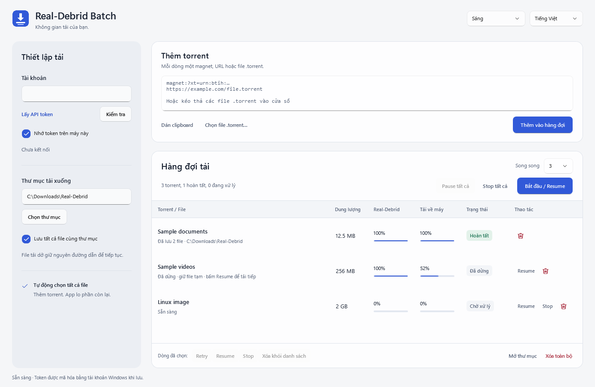
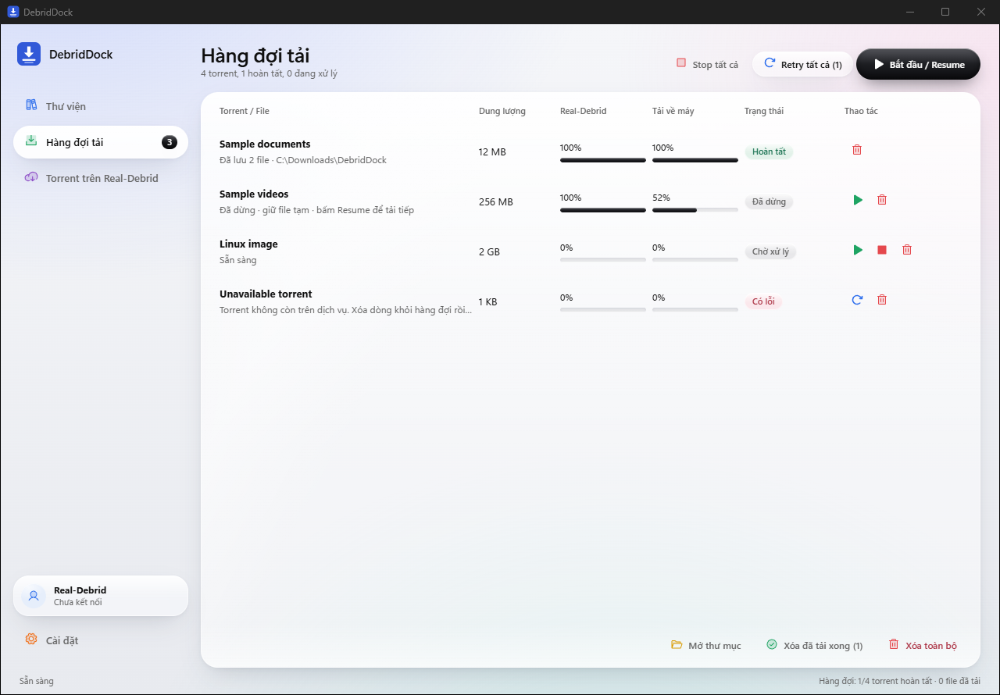
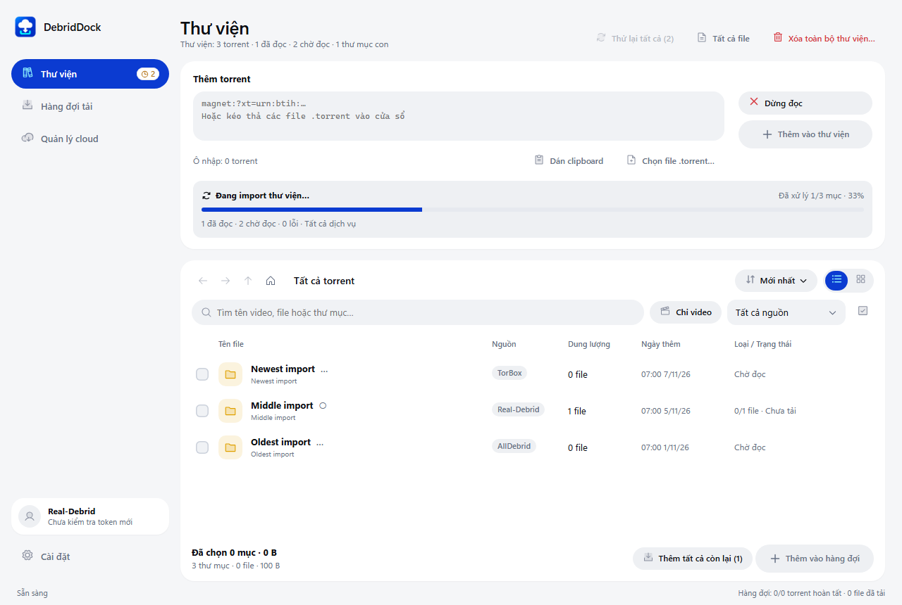
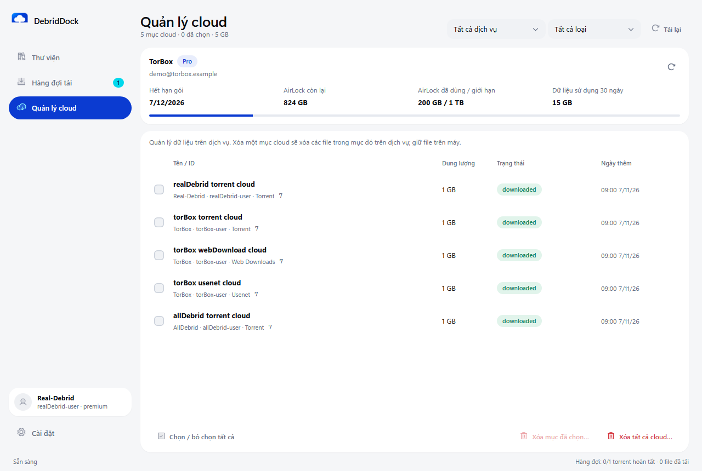
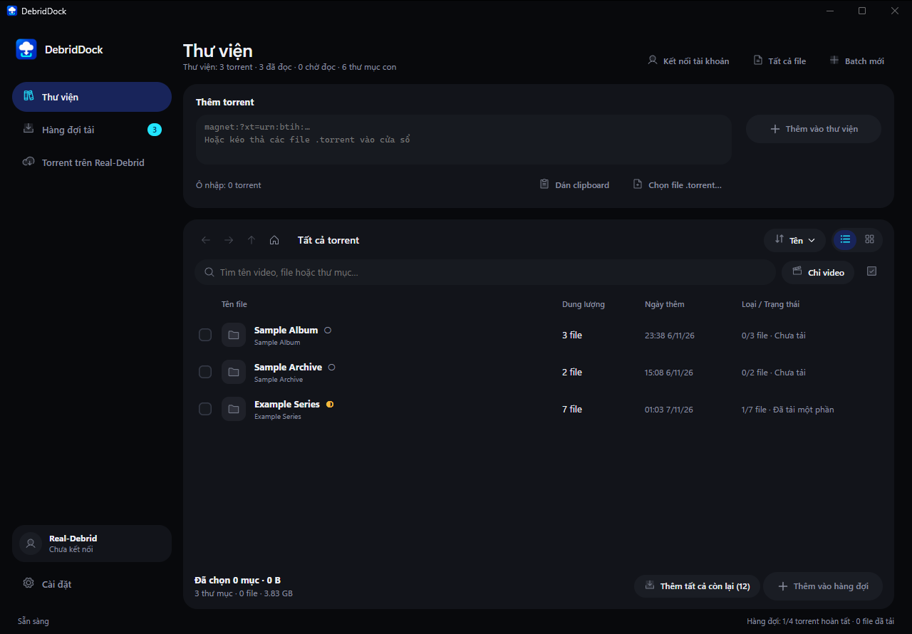
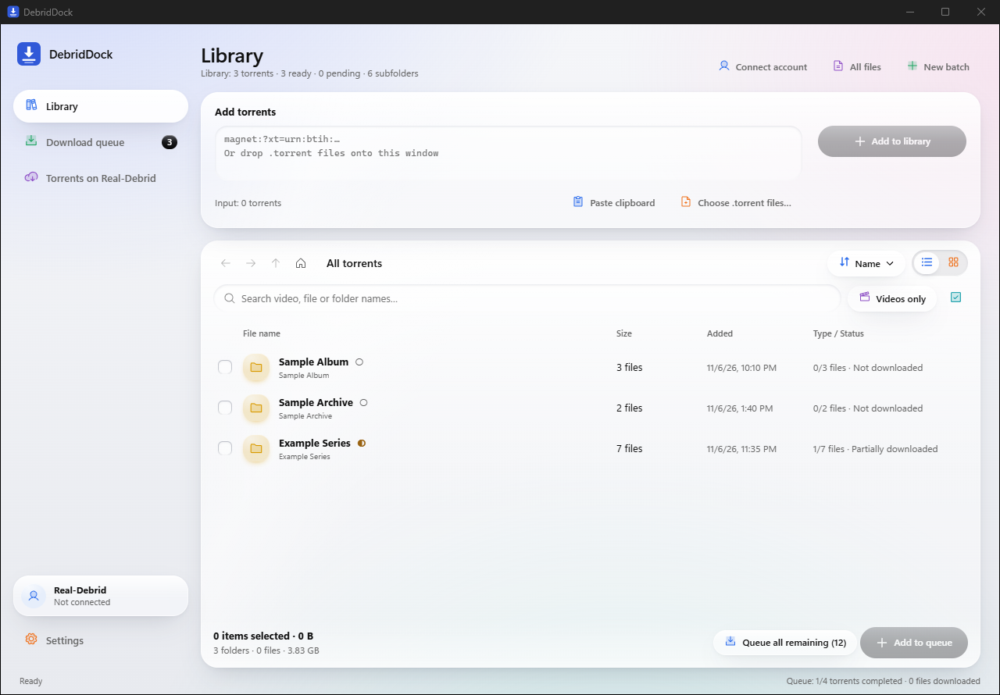

# DebridDock: ứng dụng all-in-one cho Real-Debrid, TorBox và AllDebrid

[English](README.md) · Tiếng Việt

[](https://github.com/coolbirdzik/debrid-torrent-downloader/actions/workflows/build.yml)


**DebridDock là ứng dụng debrid miễn phí cho máy tính: một app duy nhất để thêm torrent vào Real-Debrid, TorBox hoặc
AllDebrid, duyệt chúng trong thư viện ảo, chọn đúng file cần lấy rồi tải về máy qua một hàng đợi tải nhanh, có thể
tiếp tục (resume).** Không còn phải mở nhiều tab web, copy từng link và dùng thêm một trình quản lý tải riêng cho mỗi
dịch vụ debrid. Chạy trên Windows, macOS và Linux.



## Mục lục

- [Vì sao dùng DebridDock](#vì-sao-dùng-debriddock)
- [Tính năng](#tính-năng)
- [Cách hoạt động](#cách-hoạt-động)
- [Ảnh chụp màn hình](#ảnh-chụp-màn-hình)
- [Tải về và cài đặt](#tải-về-và-cài-đặt)
- [Câu hỏi thường gặp](#câu-hỏi-thường-gặp)
- [Dành cho lập trình viên](#dành-cho-lập-trình-viên)

## Vì sao dùng DebridDock

Dịch vụ debrid tải torrent trên máy chủ tốc độ cao của họ rồi đưa cho bạn link tải HTTPS trực tiếp. Làm tay cho cả
một mùa phim hay một loạt torrent nghĩa là phải thêm từng magnet trên web, chờ, chọn file, unrestrict từng link rồi
đưa link vào trình quản lý tải. DebridDock làm trọn chuỗi đó trong một cửa sổ:

- **Một giao diện cho mọi dịch vụ debrid.** Real-Debrid, TorBox và AllDebrid dùng chung thư viện, hàng đợi và cách
  thao tác. Kết nối từng dịch vụ trong Cài đặt rồi dùng cùng lúc; mỗi dịch vụ giữ token và tài khoản riêng.
- **Thư viện ảo thay cho một đống link.** Torrent được đọc trên dịch vụ và hiện thành thư mục, file như trình quản lý
  file, trước khi có bất kỳ thứ gì ghi xuống ổ đĩa.
- **Chỉ tải những gì bạn chọn về máy.** Chọn từng video, cả thư mục hoặc toàn bộ phần còn lại. Dịch vụ có thể lấy cả
  torrent lên cloud; hàng đợi trên máy chỉ tải những file bạn đã chọn.
- **Hàng đợi tải cứ để đó mà chạy.** Thêm vào là tải ngay, tiếp tục được sau khi dừng hay app bị tắt, tự thử lại khi
  rớt mạng.

## Tính năng

### Ứng dụng debrid all-in-one

- Dùng **Real-Debrid, TorBox và AllDebrid cùng lúc**, mỗi dịch vụ giữ một token riêng.
- Thêm **link magnet**, **URL `.torrent`** hoặc **file `.torrent` trên máy** (dán cả danh sách, hoặc kéo thả file vào
  cửa sổ). Khi kết nối nhiều dịch vụ, chọn **một, vài hoặc tất cả** cho mỗi lần import, hoặc nhớ lựa chọn để dùng lại.
- Phát hiện torrent trùng theo từng dịch vụ. Khi cùng một file của torrent có trên nhiều dịch vụ, thao tác thêm vào
  hàng đợi tránh tải trùng file và ưu tiên bản cloud đã tải được nhiều hơn.

### Thư viện torrent ảo

- Duyệt mọi torrent dưới dạng **thư mục và file**, có lùi, tiến, lên một cấp (dùng được nút bên hông chuột, Alt+←/→
  và Backspace), breadcrumb và chế độ **Tất cả file** dạng phẳng.
- **Xem dạng danh sách hoặc lưới**, mặc định ngày thêm mới nhất lên đầu; có sắp xếp theo tên, ngày thêm và tiêu đề cột
  (tên, nhà cung cấp, dung lượng, ngày, trạng thái). Bộ lọc **Nhà cung cấp** luôn có, kể cả khi thư viện trống.
- **Tìm kiếm** trong thư mục và mọi thư mục con, bộ lọc **Chỉ video** hiện mọi video trong cây thư mục hiện tại.
- **Thanh tiến độ import** hiện số đã xử lý và phần trăm của lượt đang chạy, kèm số đã đọc, còn chờ và lỗi trên tất
  cả dịch vụ. Có thể dừng import, thử lại mục còn chờ và xem trạng thái chờ tài khoản hoặc chờ thử lại. Mục pending
  được lưu qua lần khởi động lại và tự thử lại khi import không bị tạm dừng; bấm Thử lại để tiếp tục phần đã dừng.
  Cột **Loại / Trạng thái** hiện phần trăm và thanh tiến độ riêng của từng torrent theo dữ liệu dịch vụ, cập nhật
  cả lúc chờ metadata; khi chưa có số liệu, hiển thị trạng thái chờ. Chế độ lưới hiển thị tương tự.
- Hai **badge riêng ở menu Thư viện**: số torrent chờ đọc metadata và số file mới chưa xem. Mở Thư viện sẽ xóa badge
  chưa xem; badge pending vẫn còn đến khi có danh sách file. Cùng một file trên nhiều dịch vụ chỉ tính một lần trong
  badge file mới.
- Mỗi file cho biết **đã tải xong, tải một phần hay đã có trong hàng đợi**, và giữ dấu đó kể cả khi xóa hàng đợi
  hay mở lại app.
- Bỏ file hoặc thư mục khỏi thư viện mà không đụng tới ổ đĩa hay dịch vụ, có hoàn tác (Ctrl+Z).
- **Shift+click** hoặc **Shift+phím mũi tên** chọn theo khoảng ở Thư viện (danh sách/lưới), Hàng đợi và Quản lý cloud.
  Ctrl/Cmd+click chọn từng mục; Shift+click checkbox chọn hoặc bỏ chọn cả khoảng. Ctrl/Cmd+A chọn tất cả mục trong
  chế độ xem hiện tại, kể cả các dòng nằm ngoài vùng cuộn đang hiển thị.
- **Xóa toàn bộ thư viện** xác nhận xóa mục của tất cả nhà cung cấp, kể cả mục đang chờ đọc, rồi đặt lại ô nhập và
  bộ lọc. Giữ nguyên hàng đợi tải, file trên máy và dữ liệu cloud.

### Quản lý cloud và tài khoản TorBox

- **Quản lý cloud** có mục menu riêng. Xem torrent của cả ba dịch vụ và các mục **Web Downloads, Usenet đã có trên
  TorBox**, lọc theo nhà cung cấp và loại dữ liệu.
- **Ngày thêm mới nhất lên đầu** trên toàn danh sách, xuyên suốt nhà cung cấp và loại dữ liệu. Mỗi dòng hiện dịch vụ,
  tài khoản, loại, ID, dung lượng, trạng thái và ngày thêm; phần đầu hiện số mục và tổng dung lượng.
  Bấm cột **Tên / ID, Dung lượng, Trạng thái hoặc Ngày thêm** để tăng dần, giảm dần, rồi trở về thứ tự mặc định.
- **Xóa mục đã chọn** hoặc **Xóa tất cả cloud** trong bộ lọc nhà cung cấp/loại dữ liệu hiện tại. Cả hai đều cho xem lại
  đúng danh sách và tài khoản trong modal xác nhận có danh sách cuộn. Lệnh xóa giữ đúng tài khoản dù đổi Cài đặt; mục lỗi vẫn hiện để xử
  lý tiếp. Xóa tất cả bị vô hiệu khi đang tải danh sách hoặc một phần phạm vi đó chưa tải được.
- Xóa cloud xóa mục và các file bên trong trên dịch vụ, đồng thời dừng và bỏ tác vụ tải liên quan khỏi hàng đợi.
  File trên máy được giữ lại. Thao tác này tách riêng với xóa thư viện ảo.
- **Bảng tài khoản TorBox** trong Cài đặt và Quản lý cloud hiện đúng gói Free / Essential / Standard / Pro, ngày hết
  hạn, **AirLock đã dùng / giới hạn / còn lại**, **dữ liệu sử dụng 30 ngày** và nút làm mới. Nếu thiếu dữ liệu hạn mức,
  bảng báo chưa có thông tin. Dung lượng AirLock và lưu lượng sử dụng được hiển thị riêng.
- **Bảng tài khoản Real-Debrid** hiện tên/email, loại Premium hoặc Free, ngày hết hạn, thời gian Premium còn lại và
  điểm Fidelity, kèm nút làm mới riêng. Bộ lọc nhà cung cấp trong Quản lý cloud cũng lọc các bảng tài khoản.

### Tải torrent từ debrid

- **Thêm file đã chọn, hoặc mọi file còn lại** trong thư viện vào hàng đợi chỉ với một cú bấm. Tải bắt đầu ngay.
  Thêm lại file đã có trong hàng đợi sẽ hiện toast cảnh báo số file trùng; chỉ thêm những file mới.
- **Tải có resume** (`Range` + `If-Range`): dừng, tạm dừng hoặc tắt app, lần sau tải tiếp đúng từ byte đã dừng.
- **Tự động thử lại:** rớt mạng, quá thời gian chờ hay link tải hết hạn đều được thử lại với thời gian chờ tăng dần
  và tải tiếp phần dở. Nút **Retry tất cả** dành cho những gì vẫn lỗi.
- Chọn **thư mục lưu**, giữ cấu trúc thư mục của torrent hoặc lưu phẳng, mặc định chạy **1 đến 5 torrent cùng lúc
  trên mỗi cloud**. Đặt 5 thì Real-Debrid, TorBox và AllDebrid mỗi bên có tối đa 5 torrent chạy độc lập. Tắt
  **Tải song song độc lập giữa các cloud** trong Cài đặt để dùng chung một giới hạn tổng.
  Thay đổi giới hạn và chế độ áp dụng khi hàng đợi hết tác vụ đang chạy; Pause tất cả rồi Resume để áp dụng ngay.
- Tiến độ hiện cả hai phía: tiến độ trên dịch vụ và tiến độ tải về máy, kèm tốc độ và số file.

### Nhanh, riêng tư, đa nền tảng

- Viết bằng **Rust** (engine tải) và **Tauri 2** (vỏ ứng dụng native) nên nhẹ và tốn ít RAM.
- Vẫn mượt với **hơn 30.000 file** trong thư viện và **hàng nghìn file** trong một torrent.
- API token nằm trong **keychain của hệ điều hành** (Windows Credential Manager, macOS Keychain, Linux Secret
  Service), không bao giờ ghi vào file cài đặt dạng thường, không bao giờ hiện trong thông báo lỗi.
- Bộ cài cho Windows, macOS và Linux, cùng **bản portable cho Windows** giữ toàn bộ dữ liệu cạnh file chạy.
- Giao diện tiếng Việt, tiếng Anh, tiếng Trung giản thể, tiếng Thổ Nhĩ Kỳ, tiếng Tây Ban Nha, tiếng Đức, tiếng Pháp, tiếng Hàn, tiếng Nhật, tiếng Bồ Đào Nha (Brazil) và tiếng Nga; chế độ sáng và tối.
- **Cập nhật trong ứng dụng** ở Cài đặt: hiện tiến độ tải, xác thực chữ ký, lưu và tạm dừng hàng đợi rồi cài đặt và
  khởi động lại. Bản portable Windows giữ nguyên thư mục `data`; sau khi mở lại, bấm Resume để tiếp tục hàng đợi.

## Cách hoạt động

1. **Kết nối các dịch vụ.** Trong Cài đặt, dán và kiểm tra API token của từng dịch vụ muốn dùng. App có nút mở trang
   lấy token; thông tin tài khoản TorBox hiện sau khi kết nối.
2. **Thêm torrent.** Dán link magnet hoặc URL `.torrent`, hoặc thả file `.torrent` vào. DebridDock thêm chúng vào tài
   khoản dịch vụ đã chọn và đọc danh sách file. Theo dõi tiến độ import, thử lại hoặc dừng khi cần.
3. **Duyệt và chọn.** Mặc định mục mới thêm lên đầu. Lọc theo nhà cung cấp, mở thư mục, tìm kiếm hoặc lọc video rồi
   chọn những file/thư mục cần tải.
4. **Tải về.** Bấm **Thêm vào hàng đợi**, chọn nơi lưu và xác nhận. Các tác vụ mới bắt đầu ngay; DebridDock chờ cloud
   chuẩn bị xong, lấy link trực tiếp và tải file đã chọn về máy, có resume và tự thử lại.
5. **Quản lý cloud riêng.** Mở **Quản lý cloud** để xem hoặc xóa mục trên dịch vụ. Xóa Thư viện vẫn giữ các mục cloud
   và hàng đợi hiện có.

DebridDock không tự kết nối tới peer torrent nào: máy bạn chỉ tải qua HTTPS từ dịch vụ debrid.

## Ảnh chụp màn hình







<details>
<summary>Giao diện tối và bản tiếng Anh</summary>





</details>

Ảnh chụp giao diện ứng dụng với dữ liệu mẫu, không dùng tài khoản thật hay thực hiện tải thật.

## Tải về và cài đặt

Tải bộ cài cho hệ điều hành của bạn ở trang [Releases](https://github.com/coolbirdzik/debrid-torrent-downloader/releases): `.msi`
hoặc `.exe` cho Windows, `.dmg` cho macOS, `.deb`, `.rpm` hoặc `.AppImage` cho Linux. Với Windows còn có
`DebridDock-portable-win-x64.zip`: giải nén ở đâu cũng chạy được `DebridDock.exe`, hàng đợi, thư viện và cài đặt nằm
trong thư mục `data` cạnh file chạy (cần có WebView2 runtime, Windows 11 có sẵn). Cũng có thể build từ mã nguồn bằng
`pnpm build:portable` (xem [Build và test](#build-và-test)).

Bản Windows `-setup.exe` cho chọn thư mục cài đặt, kể cả ổ khác như `D:\Apps\DebridDock`, và chọn cài cho tài khoản
hiện tại hoặc mọi người dùng. Thư mục được bảo vệ như `D:\Program Files\DebridDock` cần quyền quản trị; chọn cài
cho mọi người dùng và chấp nhận yêu cầu quyền admin của Windows. Nếu setup cũ báo **Error opening file for writing**,
hủy rồi chạy lại bằng **Run as administrator**, hoặc chọn thư mục tài khoản của bạn có quyền ghi. Đóng bản app đã
cài đang chạy trước khi cài lại.

Sau khi cài, dùng **Cài đặt → Cập nhật → Cập nhật và khởi động lại** khi có bản cập nhật đã ký tương thích.
Với bản phát hành cũ chưa có gói cập nhật, vẫn có thể tải từ trang release.

Bản build **chưa có chữ ký Authenticode Windows hay notarization macOS**, nên hệ điều hành có thể cảnh báo ở lần
mở đầu tiên. Chữ ký bản cập nhật được dùng riêng để xác thực gói tải trong ứng dụng:

- **Windows:** SmartScreen hiện "Windows protected your PC". Bấm *More info*, rồi *Run anyway*.
- **macOS:** chuột phải vào app, chọn *Open*, hoặc chạy `xattr -dr com.apple.quarantine "/Applications/DebridDock.app"`.
- **Linux:** AppImage cần `chmod +x`. Để nhớ API token, gói `.deb` và `.rpm` cần keyring Secret Service (GNOME Keyring
  hoặc KWallet).

## Câu hỏi thường gặp

**Dịch vụ debrid là gì?**
Là dịch vụ trả phí như Real-Debrid, TorBox hay AllDebrid, tải torrent (và file từ các trang lưu trữ) trên máy chủ của
họ rồi cho bạn link tải trực tiếp tốc độ cao. DebridDock là ứng dụng khách cho các dịch vụ đó; bạn cần tài khoản và
API token của riêng mình.

**DebridDock có miễn phí không?**
Có. DebridDock miễn phí và mã nguồn mở (MIT). Bạn chỉ trả tiền gói debrid của mình.

**DebridDock có tải torrent bằng BitTorrent trên máy tôi không?**
Không. Dịch vụ debrid lấy torrent. DebridDock chỉ tải file đã xong qua HTTPS, nên không peer nào thấy IP của bạn.

**Có tải được chỉ vài file trong torrent, ví dụ một tập phim, không?**
Được. Mở torrent trong thư viện, chọn file hoặc thư mục cần lấy rồi thêm vào hàng đợi. Chỉ những file đó được tải về
máy. TorBox và AllDebrid lấy torrent lên cloud mà không chọn riêng từng file; lựa chọn trong DebridDock quyết định
phần tải về máy.

**Rớt mạng hoặc tắt app giữa chừng thì sao?**
File dở được giữ lại. Lỗi kết nối được tự thử lại, và sau khi mở lại app, **Bắt đầu / Resume** tải tiếp mọi file từ
đúng byte đã dừng.

**Dùng được nhiều tài khoản debrid không?**
Có: mỗi dịch vụ giữ một token và có thể dùng Real-Debrid, TorBox, AllDebrid cùng lúc. Chọn dịch vụ khi import, lọc
Thư viện theo nhà cung cấp và quản lý mục từ xa trong Quản lý cloud. Mỗi torrent trong hàng đợi nhớ nhà cung cấp,
tài khoản gốc và không tiếp tục bằng tài khoản khác.

**Xóa Thư viện khác gì xóa cloud?**
**Xóa toàn bộ thư viện** bỏ mục ảo của tất cả nhà cung cấp, giữ hàng đợi, file trên máy và các mục cloud.
**Xóa tất cả cloud** áp dụng bộ lọc hiện tại của Quản lý cloud, cho xem lại danh sách rồi xóa trên dịch vụ và
dừng/bỏ tác vụ tải liên quan khỏi hàng đợi. Cả hai đều giữ file trên máy.

**Hai badge ở menu Thư viện có ý nghĩa gì?**
Đồng hồ đếm torrent đang chờ danh sách file. Badge file có dấu cộng đếm file mới chưa xem và tự hết khi mở Thư viện.
Cả hai tính trên mọi dịch vụ, không phụ thuộc bộ lọc Thư viện hiện tại.

**Dung lượng còn lại của TorBox là gì?**
Đó là **dung lượng lưu trữ AirLock còn lại**, tính từ hạn mức và dung lượng đã dùng do TorBox trả về. Dữ liệu sử dụng
30 ngày là lưu lượng, không phải dung lượng lưu trữ trống. Nếu API không trả hạn mức, bảng báo chưa có thông tin.

**Token và dữ liệu được lưu ở đâu?**
Token nằm trong keychain của hệ điều hành khi bật nhớ token. Thư viện, hàng đợi và cài đặt nằm trong file `data.json`
ở thư mục dữ liệu của app, hoặc `data/data.json` cạnh file thực thi nếu dùng bản portable.

Vui lòng chỉ tải nội dung bạn có quyền tải.

## Dành cho lập trình viên

DebridDock gồm lõi và engine tải viết bằng Rust, vỏ Tauri 2 và giao diện Svelte 5.

### Cấu trúc thư mục

| Đường dẫn | Nội dung |
| --- | --- |
| `crates/core` | `rdbatch-core`: adapter cho từng dịch vụ, downloader có resume, engine hàng đợi, lưu trữ. Không phụ thuộc UI hay Tauri nên `cargo test` chạy ở đâu cũng được. |
| `src-tauri` | `rdbatch-desktop`: trạng thái ứng dụng, lệnh IPC, sự kiện gộp, truy cập keychain. |
| `src` | Giao diện Svelte. `src/lib/browser.ts` xử lý duyệt Library; `src/lib/remote.ts` quản lý phạm vi cloud và xem lại trước khi xóa; `TorBoxAccount.svelte` hiển thị thông tin tài khoản. |
| `scripts` | Kiểm tra bản dịch, dữ liệu mẫu/server giả, build portable, tạo manifest cập nhật đã ký và các bài test. |
| `.github/workflows/build.yml` | Test trên cả ba hệ điều hành, build bộ cài và phát hành release. |

### Build và test

Yêu cầu: Rust (stable), Node 22+, pnpm 10. Trên Linux cần thêm
`libwebkit2gtk-4.1-dev libayatana-appindicator3-dev librsvg2-dev libdbus-1-dev patchelf`.

```sh
pnpm install
pnpm tauri dev            # chạy app
cargo test --workspace
pnpm check && pnpm test && node scripts/check-i18n.mjs
pnpm test:updater         # test logic UI cập nhật và manifest release
pnpm tauri build          # bộ cài cho hệ điều hành hiện tại, trong target/release/bundle
pnpm build:portable       # bản portable, trong dist/portable và dist/DebridDock-portable-win-x64.zip (Windows)
```

Trên Windows, `powershell -NoProfile -ExecutionPolicy Bypass -File scripts/test-portable-update.ps1` kiểm tra thay
file portable và khôi phục khi lỗi bằng dữ liệu tạm.

`RDBATCH_DATA_DIR=<thư mục>` gom toàn bộ dữ liệu (hàng đợi, thư viện, cài đặt) vào một thư mục: dùng portable, test,
chụp ảnh. Bản portable có sẵn file `portable` cạnh file chạy, làm điều tương tự với thư mục `data` ngay bên cạnh.
API token không bao giờ ghi vào đó; token nằm trong keychain của hệ điều hành và tạm giữ trong bộ nhớ nếu máy không có
keychain.

### Vì sao nhanh

- Tiến độ không bao giờ gửi theo từng chunk. Engine cập nhật hàng đợi; một task gửi bản mới nhất của mỗi job thay đổi
  khoảng 250 ms một lần. UI bận không làm chậm việc tải, việc tải nhanh không làm ngập UI.
- Khi resume, mọi file của torrent được ghép trong một lượt, nên torrent hàng nghìn file cũng tiếp tục ngay.
- `data.json` được ghi nguyên tử và gộp lần ghi, trừ khi vừa tạo ID torrent từ xa: lúc đó ghi ngay để lỡ crash cũng
  không để lại torrent mồ côi trên dịch vụ.
- Danh sách được ảo hóa; thư viện lọc 30.000 file trong vài mili giây (`browser.test.ts` kiểm tra).

### Các quy tắc an toàn được test

Resume bằng `Range` + `If-Range`, tải lại từ đầu khi server bỏ qua `Range`, từ chối `Content-Range` sai, không coi
body bị cụt là đã xong, không bao giờ ghi đè file đã hoàn tất, giữ file dở khi dừng, từ chối path traversal và thư mục
symlink, tự thử lại lỗi kết nối nhưng không bao giờ gửi lại upload hoặc xóa chưa rõ kết quả, không để token lọt vào
bất kỳ thông báo lỗi nào (kể cả URL tải của TorBox), từ chối torrent thuộc tài khoản hoặc dịch vụ khác.
Test cloud còn kiểm tra tách biệt nhà cung cấp/tài khoản/loại dữ liệu khi trùng ID, xem lại phạm vi xóa hàng loạt và
trường hợp TorBox không trả hạn mức.

### Phát hành

Trong **Cài đặt → Cập nhật**, bấm **Cập nhật và khởi động lại** để ứng dụng tự tải bản mới, xác thực chữ ký,
tạm dừng và lưu hàng đợi, cài đặt rồi tự mở lại. Bản portable Windows thay đúng file thực thi đang chạy,
giữ nguyên file `portable` và thư mục `data`. Sau khi mở lại, bấm Resume để tiếp tục hàng đợi.
Các bản phát hành cũ chưa có `latest.json` vẫn có liên kết xem trên GitHub.

Trước khi phát hành bản đầu tiên hỗ trợ cập nhật, thêm GitHub Actions repository secret
`TAURI_SIGNING_PRIVATE_KEY` với nội dung khóa riêng khớp public key trong `src-tauri/tauri.conf.json`
(ID hiện tại: **94A0B6283CDB90F6**). Build ký trên máy cũng phải dùng đúng khóa riêng này.
Nếu khóa có mật khẩu, thêm `TAURI_SIGNING_PRIVATE_KEY_PASSWORD`. Sao lưu khóa riêng an toàn, không commit
vào Git và giữ nguyên khóa khi phát hành các bản tiếp theo để người dùng cũ xác thực được cập nhật.
App đã build với public key sai trước đây cần cài thủ công một lần bản đã sửa; sửa source không đổi được khóa
đã nhúng trong file thực thi đang cài trên máy.

Pipeline tạo các gói và chữ ký cập nhật cho Windows, macOS, Linux cùng `latest.json`; riêng portable Windows
có file thực thi được ký riêng. Build theo tag kiểm tra khóa ký có khớp public key trước khi build, rồi xác minh
chữ ký, nội dung và phiên bản của từng gói trước khi tạo manifest. Thiếu gói hoặc chữ ký sai sẽ dừng phát hành.
Chữ ký cập nhật này độc lập với Authenticode Windows và notarization macOS.

`scripts/update-manifest.mjs` lấy repo phát hành từ endpoint updater trong `src-tauri/tauri.conf.json` và đối chiếu
với `GITHUB_REPOSITORY` của CI. Khi đổi tên repo, cập nhật cả URL kiểm tra release và tiền tố URL tin cậy trong
`src-tauri/src/update.rs`; các bài test kiểm tra những URL này khớp nhau.

`.github/workflows/build.yml` test và build bộ cài trên mỗi lần push lên `main` và mỗi pull request (lưu dạng
artifact 14 ngày). Với tag `vX.Y.Z` khớp `version` trong `package.json` (app, bộ cài và kiểm tra cập nhật đều đọc từ
đây), workflow còn phát hành GitHub release kèm checksum. Thay `X.Y.Z` bên dưới bằng phiên bản đó sau khi cập nhật
các file phiên bản:

```sh
git tag -a vX.Y.Z -m "Release vX.Y.Z"
git push origin vX.Y.Z
```

### Lịch sử

DebridDock trước đây tên Real-Debrid Batch, đổi tên khi hỗ trợ nhiều dịch vụ. Dự án bắt đầu là app WPF/.NET chỉ chạy
trên Windows; phần code đó đã bị xóa khi app Tauri thay thế và vẫn xem được trong lịch sử git đến commit `8e3a5d1`.

## Giấy phép

MIT.
